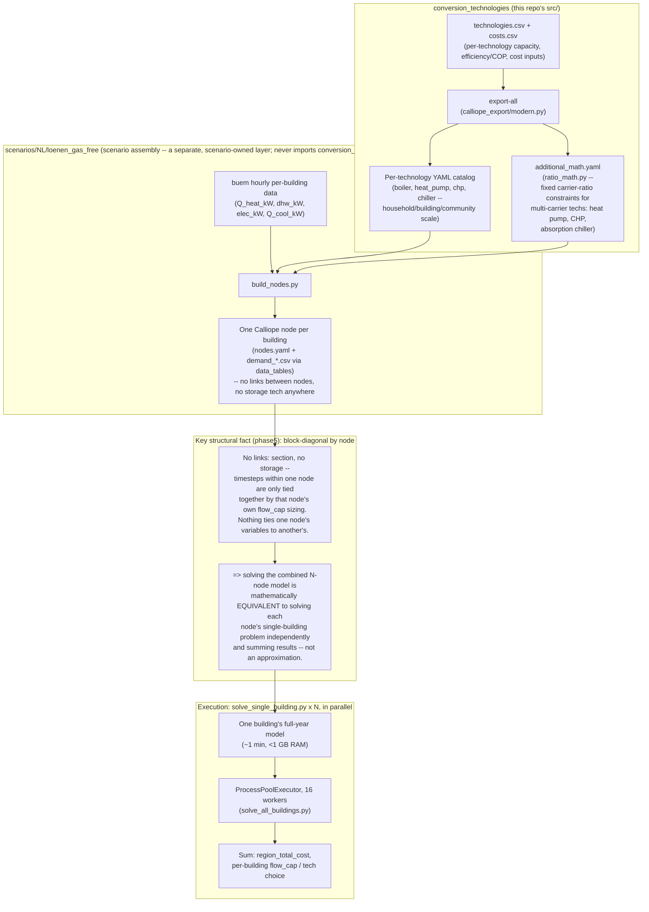

# Architecture for `enerplanet`: per-building decomposition for large-community solves

**Written for: an EnerPlanET developer evaluating `enerplanet/simulation-engine`'s
architecture for large communities.** This is the one idea from this
scenario worth carrying into `enerplanet` directly: a large community's
energy-system optimization does **not** need to be solved as one combined
model. It can be split into one independent sub-problem per building, solved
in parallel, and summed — and for this scenario's real topology, that split
is mathematically exact, not an approximation. Full derivation:
`docs/phase5_per_building_decomposition.md`. This document is the
high-level picture; that one has the formal argument and the empirical
evidence.

## Why this matters for `enerplanet`

A single combined Calliope model over this scenario's 1,260 buildings
(hourly, full year) never finished building, under **either** Calliope
0.7.0 or 0.6.10 — unbounded memory growth, no plateau, confirmed
independently of solver choice (`docs/phase4_solve.md`,
`docs/phase4b_solve_0610_sizing.md`). That is very likely a general property
of building one dense per-node/per-timestep LP at this scale, not a bug in
one Calliope version. Any `enerplanet` deployment aiming at full
per-building resolution for a real community will hit the same wall.

The per-building decomposition below sidesteps it entirely: the same full
community, full year, full hourly resolution solved in ~80 minutes on a
22-core development machine (extrapolated from a measured 16-way parallel
batch), each individual building's solve taking under 1 minute and well
under 1 GB of memory.

## The mechanism: one shared LP vs. N independent ones

A combined model puts every building's capacity-sizing variables inside one
shared backend build, which is exactly what grew unbounded in memory.
Nothing links one building's variables to another's in the real model
(`nodes.yaml` has no `links:` and no `storage` tech anywhere), so the split
below is exact, not an approximation:

<svg viewBox="0 0 800 300" role="img" aria-label="Comparison: a combined model solves all buildings' timesteps together through one shared capacity-sizing block and grows unbounded in memory as node count rises; the decomposed model solves each building's own timesteps against its own capacity-sizing block independently, so N small solves run in parallel and are summed.">
  <defs>
    <marker id="arrow" viewBox="0 0 10 10" refX="8" refY="5" markerWidth="7" markerHeight="7" orient="auto-start-reverse">
      <path d="M0,0 L10,5 L0,10 z" fill="currentColor"/>
    </marker>
  </defs>

  <text x="14" y="26" font-family="monospace" font-size="13" font-weight="600" fill="currentColor">Combined model (one calliope.Model, N nodes)</text>
  <rect x="14" y="40" width="772" height="68" rx="8" fill="none" stroke="#9a4a3a" stroke-width="1.5"/>
  <g font-family="monospace" font-size="11" fill="currentColor">
    <rect x="28" y="54" width="110" height="40" rx="4" fill="#f5e7e2" stroke="#9a4a3a"/>
    <text x="83" y="78" text-anchor="middle">bldg 1 vars</text>
    <rect x="150" y="54" width="110" height="40" rx="4" fill="#f5e7e2" stroke="#9a4a3a"/>
    <text x="205" y="78" text-anchor="middle">bldg 2 vars</text>
    <text x="282" y="80" font-size="16">&hellip;</text>
    <rect x="320" y="54" width="130" height="40" rx="4" fill="#f5e7e2" stroke="#9a4a3a"/>
    <text x="385" y="78" text-anchor="middle">bldg 1,260 vars</text>
  </g>
  <text x="470" y="78" font-family="monospace" font-size="11" fill="#9a4a3a">one shared backend build &#8594; unbounded memory growth, never finishes at full year</text>
  <line x1="14" y1="120" x2="786" y2="120" stroke="currentColor" stroke-opacity="0.25"/>

  <text x="14" y="146" font-family="monospace" font-size="13" font-weight="600" fill="currentColor">Decomposed model (N independent one-node models)</text>
  <g font-family="monospace" font-size="11" fill="currentColor">
    <rect x="14" y="160" width="140" height="54" rx="6" fill="#e2efe9" stroke="#1f6f5c" stroke-width="1.5"/>
    <text x="84" y="183" text-anchor="middle">bldg 1 model</text>
    <text x="84" y="198" text-anchor="middle" font-size="10" fill="#5b5750">own vars + timesteps</text>

    <rect x="184" y="160" width="140" height="54" rx="6" fill="#e2efe9" stroke="#1f6f5c" stroke-width="1.5"/>
    <text x="254" y="183" text-anchor="middle">bldg 2 model</text>
    <text x="254" y="198" text-anchor="middle" font-size="10" fill="#5b5750">own vars + timesteps</text>

    <text x="368" y="192" font-size="16">&hellip;</text>

    <rect x="410" y="160" width="160" height="54" rx="6" fill="#e2efe9" stroke="#1f6f5c" stroke-width="1.5"/>
    <text x="490" y="183" text-anchor="middle">bldg 1,260 model</text>
    <text x="490" y="198" text-anchor="middle" font-size="10" fill="#5b5750">own vars + timesteps</text>
  </g>

  <line x1="84" y1="214" x2="84" y2="238" stroke="currentColor" marker-end="url(#arrow)"/>
  <line x1="254" y1="214" x2="254" y2="238" stroke="currentColor" marker-end="url(#arrow)"/>
  <line x1="490" y1="214" x2="490" y2="238" stroke="currentColor" marker-end="url(#arrow)"/>
  <text x="84" y="233" text-anchor="middle" font-family="monospace" font-size="10" fill="#5b5750">solve</text>
  <text x="254" y="233" text-anchor="middle" font-family="monospace" font-size="10" fill="#5b5750">solve</text>
  <text x="490" y="233" text-anchor="middle" font-family="monospace" font-size="10" fill="#5b5750">solve</text>

  <rect x="14" y="246" width="772" height="40" rx="8" fill="none" stroke="#1f6f5c" stroke-width="1.5"/>
  <text x="400" y="270" text-anchor="middle" font-family="monospace" font-size="12" font-weight="600" fill="#1f6f5c">sum results &#8594; region total (exact, because nothing links the buildings)</text>
</svg>

*Why the split is free: `nodes.yaml` has no `links:` between buildings and
no `storage` tech anywhere. Every variable in the combined model's big
block already belongs to exactly one building — the block-diagonal
structure was in the problem the whole time, just hidden inside one shared
solve.*

## The pipeline

A shareable, standalone version of both diagrams above (same content, no
repo access needed) is published at
<https://claude.ai/artifact/89vj4aGyYMaRSn8aSLGMMt> — that's the one to
actually send an EnerPlanET developer; this file is the versioned source
of truth it was built from.

## What to replicate inside `enerplanet`

1. **Don't build one combined LP for a large community.** If
   `enerplanet/simulation-engine` has (or is heading toward) a single
   `calliope.Model` spanning every building in a community, that is the
   exact shape that hit the memory wall here — worth checking before it's
   hit in production.
2. **Check the same structural precondition first**: does the real model
   have cross-building `links:` (shared electrical/heat network) or any
   `storage` tech? If **no** to both (as here), the decomposition above is
   exact and safe to use as-is. If the real community *does* need a shared
   network or storage, decomposition breaks down — that becomes the one
   thing that would force a combined solve (flagged, not solved, in
   `docs/phase5_per_building_decomposition.md` section on separability
   caveats).
3. **Parallelize at the building level**, not inside one solver call. Each
   building's sub-problem is small and fast; the speedup comes from running
   many of them concurrently (measured: 16 concurrent full-year solves
   finished in ~2.3x one solve's solo time, not 16x — real parallelism, not
   linear slowdown).
4. **The technology catalog (`conversion_technologies`) and the per-building
   topology (`scenarios/`) are already separated** on this side
   specifically so the catalog (per-technology YAML + cost/efficiency
   inputs) can be swapped or extended — e.g. the `chiller` category added
   for cooling — without touching how buildings are assembled into nodes,
   and vice versa. Worth keeping that same separation inside `enerplanet`'s
   own architecture if it doesn't already have it.

## Caveats carried over from the underlying docs (not re-litigated here)

- Calliope's own `additional_math.yaml` carrier-ratio constraints and this
  whole pipeline's output have been verified algebraically, not against a
  solve that printed a ground-truth cross-check from an independent
  source — see `docs/calliope_schema_mapping.md`'s standing caveat.
- The Calliope version question (0.7.0 vs. the `simulation-engine`
  Dockerfile's pinned 0.6.10) is not yet reconciled — see the status note
  at the top of `docs/phase4b_solve_0610_sizing.md`. Everything in this
  document about the decomposition's *validity* holds regardless of which
  version `enerplanet` ends up running, since it's a structural fact about
  the model (no links, no storage), not a Calliope-version-specific
  behavior.
