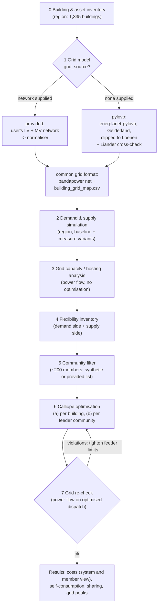

# Energy-community analysis for Loenen: workflow design

**Status: design, 2026-11-25. Nothing below is implemented yet**, except the
pieces marked *exists*. Each step is built and documented separately, as its
own phase file, in the same way as phases 0–6.

## The question

Loenen has about 1,300 households: 1,335 residential buildings in 3D BAG,
1,260 of them single-dwelling. About 200 of these households form an energy
community. The members are spread across the village, not grouped on one
street or feeder.

The question is what the community should build and operate, given:

- what members can install themselves (`measures/measures.csv`);
- the shared assets that already exist (the Thomassen rooftop PV and the
  1 MW / 2 MWh battery);
- the limits of a low-voltage grid that the members share with about 1,100
  non-members.

The method simulates the whole region first and then optimises only the
community in Calliope (EnerPlanET's optimisation layer).

Up to phase 6, each building was optimised as an island. There was no grid,
no sharing and no community. This document adds those three.

## Steps

| # | Step | Scope | Tools: *exists* / new | Output |
| --- | --- | --- | --- | --- |
| 0 | Building & asset inventory | region | *buem* `lod2_building_feature.csv` (`bag_pand_id`, centroid in EPSG:28992); *measures catalogue* | building table: BAG id, coordinates, type, roof faces, existing PV/EV/battery |
| 1 | Grid model (`grid_source`) | region | provided network → normaliser (new); or *enerplanet-pylovo* | pandapower net + `building_grid_map.csv` |
| 2 | Demand & supply simulation | region | *buem* (heat/cool), *occupancy* (electricity, EV), *`pv-profile`* (roof PV); buem envelope-retrofit variants (new) | hourly profiles per building and per variant |
| 3 | Grid capacity / hosting analysis | region | pandapower time-series power flow; *pylovo fork* `src/analysis/powerflow_analysis.py`, `src/ev_hosting.py` | loading and voltage per transformer and feeder; hourly headroom per feeder |
| 4 | Flexibility inventory | region | from steps 2–3 plus the catalogue | flexibility per building and per feeder: power, energy, time windows |
| 5 | Community filter | community | `select_members.py` (new) | `members.csv`, members per feeder |
| 6 | Calliope optimisation | community | *per-building solve* (phase 5); per-feeder community model (new) | sizing, dispatch, costs |
| 7 | Grid re-check and iterate | region | pandapower; *simulation-engine* `c2p` (Calliope → PyPSA) | violations → back to step 6 |

### Step 0: building and asset inventory

- **Coordinates (done in buem, 2026-11-25).** buem's
  `scripts/run_region_hourly.py` summary now carries `bag_pand_id`,
  `latitude` and `longitude`: the footprint centroid in WGS84, decoded from
  `building_centroid_geom` (EPSG:28992). They are filled even for buildings
  that were skipped or errored, because the grid still has to place them.
  Checked on the real table: all 1,260 scenario buildings decode, with 1,260
  unique BAG ids, between 52.078–52.151 N and 5.948–6.074 E. The existing
  `data/*.parquet` files predate this; a Phase 1 rerun adds the columns
  (the same rerun also adds `roof_faces` for PV).
- **Weather location: already correct.** buem's `_batch_weather` places the
  one shared weather fetch at the region's mean building centroid (52.12 N,
  6.03 E; `docs/phase1_demand.md`), not at the `--latitude/--longitude`
  defaults.
- **Existing assets.** Existing PV, EV and batteries per building come from
  buem (`has_pv`, `pv_capacity_kwp`, ...). Shared assets come from
  `measures/community_assets.csv`. Only operating assets enter the baseline.

### Step 1: grid model, from three sources (built: `docs/phase7_grid.md`)

`scripts/build_grid.py --source auto|provided|dso|pylovo`. `auto` takes
the first source that is available:

1. **`provided`**: the user's own network, given as `transformers.csv`
   plus either a real `building_grid_map.csv` or `lv_cables.geojson`.
2. **`dso`**: the DSO's open data. For Liander this means cable and
   station geometry (CC BY 4.0), plus a per-transformer list with ratings
   and peak loads, which **may not be shared**.
3. **`pylovo`**: a synthetic LV grid from a running enerplanet-pylovo API,
   with `--cross-check` against the DSO stations. pylovo generates LV
   only; the MV side is a single external grid per transformer.

Every source writes the same package to `data/grid/<source>/`:
`transformers.csv`, `building_grid_map.csv` (`trafo_id`, `feeder_id`,
cable distance, method), `lv_lines.geojson` and `manifest.json`.

Loenen status: built from Liander. 1,229 of 1,260 buildings are traced
along the cables to 42 stations and 103 feeders. Some buildings sit on
stations with no published rating. A pandapower `net.json` comes in
step 3, in its own environment.

### Step 2: demand and supply simulation, for the whole region (built: `docs/phase8_demand_supply.md`)

Loenen status: built. Four scenarios (baseline, standard retrofit,
advanced retrofit, EV 50%) for the 1,260 single dwellings, plus 138
background buildings (multi-unit and service) in every scenario. PV
potential for every roof and the Thomassen roof calibrated to 800 MWh/yr.
Everything is summed per Liander station. The modelled present-day
electric peak agrees closely with Liander's measured station peaks
(figures local: licensed). Cooling was fixed in buem (window sizing from TABULA, window
shading, summer window ventilation): 1.8 MWh per dwelling. The original
plan:

- **Baseline** (*exists*): buem heating and cooling, occupancy electricity
  and EV profiles, and the cooling setpoint of 26 °C. All 1,260 buildings,
  2018.
- **Measure variants** from the catalogue:
  - envelope retrofit (`buem_envelope` rows). Needs buem retrofit variants,
    for example the TABULA "usual" and "advanced" refurbishment levels.
  - PV potential per building (`pv-profile` from the roof faces, *exists*).
  - EV ownership levels.
- **Shared supply:**
  - The Thomassen rooftop PV, as a PV profile for the site. Its kWp is
    unknown, so calibrate it to about 800 MWh/yr.
  - The battery, 1 MW / 2 MWh.
- The 75 multi-unit buildings are still deferred (phase 1). This step must
  either add them or state that they are missing from the grid load.

### Step 3: grid capacity and hosting analysis (simulation only)

- Run a time-series power flow over the region for the baseline and for
  "electrified" variants: all heat pumps, EV uptake, PV uptake.
- Outputs:
  - transformer loading and feeder loading, as hourly series and as a P99;
  - voltage band violations;
  - **hourly headroom per feeder**, which becomes the import/export limit in
    step 6;
  - hosting capacity per feeder for PV, heat pumps and EVs (the pylovo fork
    already has `ev_hosting.py`).
- This turns "the grid is full" (the site's qualitative congestion note) into
  numbers per feeder.

### Step 4: flexibility inventory

| Side | Option | Model status |
| --- | --- | --- |
| demand | EV smart charging / V2G | *exists* (phase 6) |
| demand | heat pump + building thermal mass / buffer tank | needs a storage formulation for heat |
| demand | hybrid heat pump (switch fuel at peaks) | needs a technology. It is in the municipality's 2027 programme (Gemeenteblad 2026-355914) |
| demand | home battery (Wattflex: 25 households) | needs a technology |
| demand | dynamic tariff response | *exists* (day-ahead price) |
| supply | community battery, 1 MW / 2 MWh | needs a storage technology and a community node |
| supply | dimmable (curtailable) Thomassen rooftop (SmartCORE pilot) | supply with `flow_out_min_relative = 0`, which Calliope already allows |
| supply | green gas (letter of intent) | out of scope while the scenario stays gas-free |

The step produces, per building and per feeder, the flexible power and
energy available and when it is available. Step 5 uses it to compare members
with non-members. Step 6 uses it to set bounds.

### Step 5: community filter

Loenen status: `scripts/community/select_members.py` (seeded, stratified by
feeder, or a provided list); pilot of 20 on one station, see
`phase9_community_pilot.md`.

- **Default: synthetic selection.** Choose about 200 of the buildings by a
  documented, seeded rule. Options:
  - uniform random;
  - weighted by PV potential or EV ownership;
  - stratified by feeder, to match "spread across the region".
- **Repeat the draw** with several seeds. A sensitivity analysis matters
  because results depend on which feeders the members end up on.
- **Override:** a real member list, given as anonymised `bag_pand_id`s that
  never leave the local `data/` folder. When a list is supplied it replaces
  the synthetic draw.
- **Representativeness check:** compare members with the region by building
  age, type, demand, roof potential and EV share.

### Step 6: Calliope optimisation

Loenen status: pilot built (`scripts/community/build_community.py`,
`solve_community.py`): independent, community, and community with an
hourly station limit; home and community batteries and grid export added.
See `phase9_community_pilot.md`, which also maps the variants to the
EnerPlanET S1-S4 experiments.

There are two tiers:

**(a) Per-building investment** (*exists*, phase 5). Every member gets its
own building model, extended with catalogue measures: PV (exists), heat pump
(exists), home battery (to add), and insulation as a demand variant. This
tier stays exact and parallel because nothing is shared.

**(b) Community model per feeder or transformer** (new). Sharing couples
buildings: a shared battery, a shared feeder limit, and energy sharing
between members. So the per-building split is **no longer exact** (phase 5,
§5 and §7). Instead, split by transformer:

- One Calliope model per transformer area. Members on that area each get a
  node, plus one community node holding the shared assets that sit on that
  transformer. The Thomassen PV and battery go on their actual transformer.
- Links between member nodes and the community node carry the shared
  energy.
- The community node's import and export with the external grid is limited
  by the step 3 headroom. **Non-members are not optimised.** Their load
  enters only through that headroom, as a fixed background.
- Size: about 200 members spread over the region gives a few to a few dozen
  members per transformer. That is small enough for one joint LP; phase 4's
  memory wall came from 1,260 nodes in one model.
- A pre-check step reruns the phase 5 separability test: if a transformer has
  no shared asset and no binding limit, keep its members as independent
  building solves.

**Two cost perspectives**, the same structure with different prices:

- *System*: excluding VAT and taxes, no subsidies (*exists*).
- *Member*: 2027 consumer tariffs with no net metering
  (`docs/tariffs_nl_2027.md`), with subsidies from
  `measures/subsidy_schemes.csv` (LEN 37% up to EUR 9.000, ISDE, the
  Apeldoorn insulation subsidy).

The difference between the two is the subsidy and tax wedge. That wedge is
itself a result worth reporting.

### Step 7: grid re-check and iterate

- Take the optimised member dispatch plus the non-member baseline, and run
  the full-region power flow again. This uses pandapower here, or
  simulation-engine's `c2p` (Calliope → PyPSA) inside EnerPlanET.
- If a feeder or transformer is overloaded, or voltage leaves its band:
  tighten that feeder's limit in step 6 and solve again.
- Stop when there are no violations, or after N rounds; report it either
  way.

## Changes to the original four steps, and why

The original proposal was: grid simulation, then supply and demand analysis,
then flexibility, then the community filter and Calliope. Changes:

1. **Step 0 added.** A building table with coordinates is a hard
   prerequisite for attaching buildings to any grid. Today it does not exist.
2. **The grid switch** (`provided` | `pylovo`), with one common output
   format, so the rest of the pipeline never depends on where the grid came
   from.
3. **The grid is analysed before the community is chosen** (step 3 before
   step 5). Headroom is a property of the whole region, so it has to be
   known before members are picked. Otherwise the community model cannot
   say what non-members leave free.
4. **A feedback loop (step 7).** An LP with fixed per-feeder limits does not
   see voltage or the effect of the new dispatch on the background load.
   One or two rounds of power flow close that gap.
5. **Two cost perspectives.** The community's members decide with subsidies
   and consumer tariffs. The system view does not. Reporting both shows
   where the subsidies change decisions.

## Mapping to EnerPlanET

| Step | EnerPlanET component |
| --- | --- |
| 0 | city2tabula / 3D BAG; `enerplanet/buem-gateway` (demand API) |
| 1, 3 | `enerplanet/enerplanet-pylovo` (grid engine: generation, power flow, EV hosting) |
| 2 | `enerplanet/buem`, `enerplanet/occupancy`, `enerplanet/weather`, `enerplanet/pysam-pv` |
| 6 | `enerplanet/simulation-engine` (Calliope; `calliope==0.7.0` decided) |
| 7 | `simulation-engine` `c2p` (PyPSA) |
| orchestration | `enerplanet/TentaCron` |

**Open interface.** How pylovo output reaches simulation-engine is not
documented (see `D:/test/buem-enerplanet-paper/CLAUDE.md`). The
`building_grid_map.csv` defined in step 1 is the proposed contract.

## Boundaries

- All new code lives under `scenarios/`. It uses `conversion_technologies`
  only through its CLI output (generated YAML), never through a Python
  import (repository `CLAUDE.md`).
- pylovo and pandapower dependencies go in the scenario environment, never
  in `conversion_env.yml`.
- New *technologies*, such as the stationary battery and a hybrid heat
  pump, belong in the package's CSVs. They follow the package's sourcing
  rule: every value in `docs/sources/parameter_sources.csv`. Market
  transactions (grid import and export) are scenario techs priced in
  `energy_prices.csv` (package convention #8).

## Gaps, in suggested order

1. ~~Coordinates and `bag_pand_id` in buem's summary output~~ (done
   2026-11-25, Phase 1 rerun done: hourly demand identical, new columns
   complete).
2. ~~Grid builder~~ (done 2026-11-25, Liander tier run; `phase7_grid.md`).
   Still open:
   - ratings for the unrated stations;
   - ~~an actual pylovo run and cross-check~~ (done 2026-11-25: 36 vs 42
     stations, ARI 0.57; pylovo likely oversizes).
3. ~~A stationary battery technology at household and community scale, and an
   export sink~~ (done 2026-11-25: package `new/battery/`; export is a
   scenario tech, `demand_grid_export`, like grid import).
4. ~~buem envelope-retrofit variants (step 2)~~ (done 2026-11-25, as
   region copies with lifted TABULA variants; `phase8_demand_supply.md`).
   buem's window areas, window shading and summer ventilation fixed the
   cooling (2026-11-25); all Phase 1 runs redone with `--window-ach 3`.
5. Power-flow and headroom scripts (step 3).
6. ~~`select_members.py` (step 5)~~ (done 2026-11-25, `scripts/community/`).
7. ~~A per-station community model~~ (pilot 2026-11-25,
   `scripts/community/build_community.py`; reuses `build_nodes.py` for the
   members). Still open: the member cost view.
8. A hybrid heat pump technology, if the municipal hybridisation route is to
   be compared (step 4).
